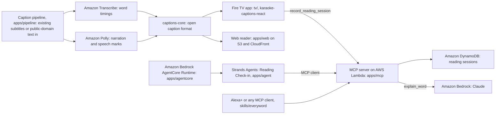

# EveryWord

Word-by-word highlighted captions for Fire TV and the web, so watching a video becomes reading practice.

Built for the Build, Ship, Shape: Amazon Developer Hackathon. Tracks: Fire TV and Alexa+. Mini challenges: AWS Builder and Open Source.

- Demo video (2:56): https://youtu.be/eCmaiAEgPWk
- Live reader: https://d34emfdcezeszz.cloudfront.net
- Fire TV APK (v0.3.2): https://github.com/usv240/everyword/releases/tag/v0.3.2
- MCP server (the Alexa+ surface): `https://bgvgejdhfhlu2inavg23d5dkj40eggxt.lambda-url.us-east-1.on.aws/mcp`
- npm: [`karaoke-captions-react`](https://www.npmjs.com/package/karaoke-captions-react) and [`@everyword/captions-core`](https://www.npmjs.com/package/@everyword/captions-core)

## What it does

- Takes the subtitle file a video already ships with, runs Amazon Transcribe on the audio, and gives every subtitle word its own time. The words stay the author's; only the timing is new (`apps/pipeline/src/upgrade.ts`, `packages/captions-core/src/align.ts`).
- Lights each word at the moment it is spoken, on a Fire TV app (`tv/`) and in a web reader (`apps/web`). Both use the same renderer package.
- Turns any public-domain text into a narrated read-along with Amazon Polly. Polly speech marks give the word timings, so these captions reproduce the source text exactly (`apps/pipeline/src/polly.ts`).
- Counts the words a reader actually followed on screen. The Fire TV app reports that count to the project's own MCP server when a story ends (`tv/src/mcp.ts`).
- Serves that progress to assistants through an MCP server with six tools, including `explain_word`, which explains a word from the story on Amazon Bedrock (`apps/mcp/src/mcp.ts`, `apps/mcp/src/explain.ts`).
- Ships the caption format and renderer as two MIT packages so any video app can adopt them (`docs/FORMAT.md`).

## Why it matters

Same Language Subtitling, karaoke-style captions in the viewer's own language on ordinary entertainment, has run on Indian national television since 1996 and became national broadcast policy there in 2019. A five-year study of 13,000 people who could initially read little or nothing found 32 percentage points more children became good readers than in the unexposed group, at about $0.004 per learner [2]. More than 100 empirical studies find captions improve comprehension, attention and memory, with people learning to read among those who gain most [1]. Ordinary subtitles carry one time per line, so no video platform can light a word today; EveryWord adds the missing word timings to content that already exists.

## Architecture



## What is real and what is simulated

- Real: the MCP server, DynamoDB table, Lambda, S3 bucket and CloudFront distribution are deployed from `infra/bin/app.ts` and live at the URLs above.
- Real: Sintel (Blender Foundation, CC BY 3.0) is a real film with the subtitles its makers shipped. Its word timings come from Amazon Transcribe on the film's audio (`apps/web/public/content/sintel.source.srt`, `sintel.recognised.json`, `sintel.captions.json`).
- Real: The Two Pots is a LibriVox human recording with captions from Amazon Transcribe.
- Synthetic narration: four of the five fables are read by Amazon Polly neural voices (Joanna, Matthew, Kendra, Ivy), labelled as such in `CONTENT_LICENSES.md` and in the reader's attribution text.
- Real device, hosted: the Fire TV footage in the demo is the v0.3.2 APK running on an Amazon-hosted Fire TV (Appstore Quality Central, Live Device Interaction, FOS 14 3P TV). During the build it ran on an Android Virtual Device. Details in `docs/FIRE_TV_TARGET.md`.
- Alexa+ surface: the MCP server is the surface an Alexa+ integration uses, and two independent clients exercise it today: the Strands agent in `apps/agent` and the live MCP panel on the website (`apps/web/src/components/McpProof.tsx`).
- Reading progress: there is no seeded data. Every number `get_reading_progress` returns comes from a `record_reading_session` call, from the Fire TV app or from a client.
- Demo reader names such as `maya` in `apps/agent/README.md` and `skills/everyword/SKILL.md` are example identifiers, not real people.

## Evidence

Timing was measured against gold Montreal Forced Aligner alignments on LibriSpeech, speech and alignments nobody on this project produced. Method in `docs/EVAL.md`.

| Measure | dev-clean | test-other | Read from |
|---|---|---|---|
| Speakers | 27 | 26 | `apps/eval/results/librispeech.json`, `apps/eval/results/librispeech-test-other.json` |
| Words matched to gold | 766 of 788 (97.2 percent) | 761 of 787 (96.7 percent) | same files, `matchedWords`, `goldWords` |
| Highlight onset error, median | 30 ms | 30 ms | `highlightOnset.medianAbsMs` |
| Highlight onset error, p90 | 85 ms | 85 ms | `highlightOnset.p90AbsMs` |
| Words lit early beyond 150 ms | 0 of 766 | 0 of 761 | `negativeControl.wordsLitEarlyBeyondTolerance` |
| Line breaks on real pauses, EveryWord | 42 percent | 42.2 percent | `lineBreaksOnRealPauses.everyword.onPausePercent` |
| Line breaks on real pauses, fixed-width chunker | 2 percent | 4.1 percent | `lineBreaksOnRealPauses.naiveFixedWidth.onPausePercent` |
| Lines over the 42-character budget | 0 | 0 | `linesOver42Chars` |

The zero in the early-light row is asserted as an exact zero in `apps/eval/test/claims.test.ts`. A highlight that runs ahead of the voice teaches a learning reader the wrong word, so that number is not allowed to drift.

Sintel, the subtitle upgrade path: 14 cues, 75 subtitle words, 80 words recognised by Amazon Transcribe, 74 of 75 subtitle words anchored to a recognised word (98.7 percent). Re-derived with `anchorRate` from `@everyword/captions-core` over `apps/web/public/content/sintel.source.srt` and `apps/web/public/content/sintel.recognised.json`. The displayed text is identical to the shipped subtitle file; the live site checks that in the browser.

Accessibility: Lighthouse 13.4.1 on the deployed reader scored 100 for accessibility, best practices and SEO, and 91 for performance (`docs/ACCESSIBILITY.md`).

## Research

1. Gernsbacher MA. Video Captions Benefit Everyone. *Policy Insights from the Behavioral and Brain Sciences*. 2015;2(1):195-202. PMC5214590. https://pmc.ncbi.nlm.nih.gov/articles/PMC5214590/
2. Kothari B, Bandyopadhyay T (2014). Reading for a Billion: Same Language Subtitling, India. Catalogued by the UNESCO Institute for Lifelong Learning. https://www.uil.unesco.org/en/litbase/reading-billion-same-language-subtitling-india
3. OECD Programme for the International Assessment of Adult Competencies (PIAAC) Cycle 2, US results: 28 percent of US adults (58.9 million people) at literacy Level 1 or below in 2023, up from 19 percent (48 million) in 2017. https://www.air.org/resource/report/highlights-us-piaac-cycle-2-results and https://nces.ed.gov/fastfacts/display.asp?id=69
4. Gallup for the Barbara Bush Foundation for Family Literacy (2020). 54 percent of US adults aged 16 to 74 read below a sixth-grade level, at an estimated cost to the economy of $2.2 trillion a year. https://www.barbarabush.org/new-economic-study/

Every claim, with the exact wording of its source, is in `docs/EVIDENCE.md`.

## Content licences

The five fables list their source and licence in [CONTENT_LICENSES.md](CONTENT_LICENSES.md) (all public domain); Sintel is credited to the Blender Foundation under CC BY 3.0 in `apps/web/public/content/manifest.json`.

## Run it

Node 20 or later.

```
npm install              # also installs tv/ in a postinstall step
npm test                 # 161 tests: vitest across packages and apps, then the Fire TV app's jest suite
npm run web:dev          # the reader on http://localhost:3000
npm run mcp              # the MCP server on http://127.0.0.1:8788/mcp
npm run verify:live      # probes the deployed MCP server over real HTTP (scripts/mcp-conform.mjs)
```

Caption generation needs AWS credentials and `EVERYWORD_BUCKET_SUFFIX` set to your account id (`docs/AWS.md`):

```
npm run pipeline -- --input <url|file> --name my-story --title "My Story" --attribution "..."   # Amazon Transcribe
npm run polly -- ...                                                                            # Amazon Polly
npm run upgrade -- --video sintel.mp4 --subtitles sintel.en.srt --name sintel --title "Sintel"  # upgrade existing subtitles
npm run librispeech -w @everyword/eval                                                          # rerun the evaluation
cd infra && npx cdk deploy                                                                      # site, Lambda, DynamoDB
```

Install the app on a Fire TV (from `tv/README.md`):

```
adb connect <your-fire-tv-ip>:5555
adb install everyword-tv-v0.3.2.apk     # from the v0.3.2 release
```

Build it yourself: `cd tv && npm install && npm run android`. Release build steps for Windows are in `tv/README.md`.

Reading Check-in agent (`apps/agent/README.md`):

```
pip install strands-agents strands-agents-tools
python apps/agent/reading_check_in.py --reader maya        # against a local server
python apps/agent/reading_check_in.py --url https://<function-url>/mcp
```

Hosted agent (`apps/agentcore/README.md`): `cd apps/agentcore && npx @aws/agentcore deploy --yes`, then `npx @aws/agentcore invoke --prompt "..."`.

API keys: the server is open and the television reports with no key. For readers of your own, `curl -X POST <server>/v1/keys` returns a free key with no account; send it as `Authorization: Bearer <key>` on `/mcp`.

## Tests

Run on 2026-10-22 from a checkout with `npm install` done.

```
npm run build:packages && npx vitest run     # Test Files 12 passed, Tests 149 passed
npm --prefix tv test                         # Test Suites 3 passed, Tests 12 passed
```

`npm test` runs both in sequence. The vitest run covers the caption engine and alignment (`packages/captions-core/test`), the renderer's documented API (`packages/karaoke-captions-react/test`), the MCP server's protocol, sessions, CORS and keys (`apps/mcp/test`), and the public claims: every number above is re-derived from the committed result files, the Agent Skill must name every MCP tool, and the hosted agent must be byte-identical to the local one (`apps/eval/test`). The jest run covers the Fire TV app, its library and its MCP client (`tv/__tests__`). There is no Python test suite in this repository.

## AWS and tools used

| Tool | What it does here | Where |
|---|---|---|
| Fire TV (Fire OS) | React Native TV app (react-native-tvos), D-pad focus, remote media keys, sideloadable APK | `tv/App.tsx`, `tv/android/` |
| Alexa+ via MCP | Self-hosted MCP server, spec 2025-11-25 over Streamable HTTP, six tools | `apps/mcp/src/mcp.ts` |
| Agent Skill | Tells an agent how to use the six tools; a test checks it names every one | `skills/everyword/SKILL.md` |
| Amazon Bedrock | `explain_word`: three Claude models tried in order, grounded in the story sentence | `apps/mcp/src/explain.ts` |
| Strands Agents | Reading Check-in agent, Claude on Bedrock, MCP tools only | `apps/agent/reading_check_in.py` |
| Amazon Bedrock AgentCore | Hosts that agent as a runtime (`everywordreading`, us-east-1) | `apps/agentcore/agentcore/agentcore.json` |
| Amazon Polly | Narration and word speech marks for text stories | `apps/pipeline/src/polly.ts` |
| Amazon Transcribe | Word timings for recorded speech and for the evaluation | `apps/pipeline/src/transcribe.ts`, `apps/eval/src/run-librispeech.ts` |
| Amazon DynamoDB | Append-only reading session log | `apps/mcp/src/progress.ts` |
| AWS Lambda, Amazon S3, Amazon CloudFront, AWS CDK | MCP server behind a function URL, the site, one deploy | `infra/bin/app.ts`, `apps/mcp/src/lambda.ts` |
| Amazon Devices Builder Tools | Vega documentation search during the build; it showed the platform caption path is cue-level | `docs/BUILDER_TOOLS.md` |

Product feedback is in [PRODUCT_FEEDBACK.md](PRODUCT_FEEDBACK.md). There are seventeen entries in [FRICTION_LOG.md](FRICTION_LOG.md). Feature requests are in [docs/FEATURE_REQUESTS.md](docs/FEATURE_REQUESTS.md).

## Privacy

- Stored: one row per reading session in DynamoDB, with five fields: `readerId`, `slug`, `wordsFollowed`, `completed`, `at` (`apps/mcp/src/progress.ts`). The Fire TV app reports as `firetv-household`, not a person's name (`tv/App.tsx`).
- Never recorded: audio. There is no microphone code in the web app, the TV app or the server. The app reads to the reader and follows its own cursor.
- API keys: nothing about a key is stored. Its space is a prefix of the key's SHA-256 hash, computed on every request (`apps/mcp/src/keys.ts`).
- Browser: the web reader stores only the chosen theme in `localStorage` (`ew-theme`).
- Model text: `explain_word` sends the story sentence and the word to Amazon Bedrock. No reader identifier goes with it.

## Documentation

[EVIDENCE.md](docs/EVIDENCE.md) · [EVAL.md](docs/EVAL.md) · [FORMAT.md](docs/FORMAT.md) · [AWS.md](docs/AWS.md) · [FIRE_TV_TARGET.md](docs/FIRE_TV_TARGET.md) · [DESIGN.md](docs/DESIGN.md) · [ACCESSIBILITY.md](docs/ACCESSIBILITY.md) · [BUILDER_TOOLS.md](docs/BUILDER_TOOLS.md) · [FEATURE_REQUESTS.md](docs/FEATURE_REQUESTS.md) · [VIDEO_SCRIPT.md](docs/VIDEO_SCRIPT.md) · [FRICTION_LOG.md](FRICTION_LOG.md) · [PRODUCT_FEEDBACK.md](PRODUCT_FEEDBACK.md)

## Licence

MIT. See [LICENSE](LICENSE).
